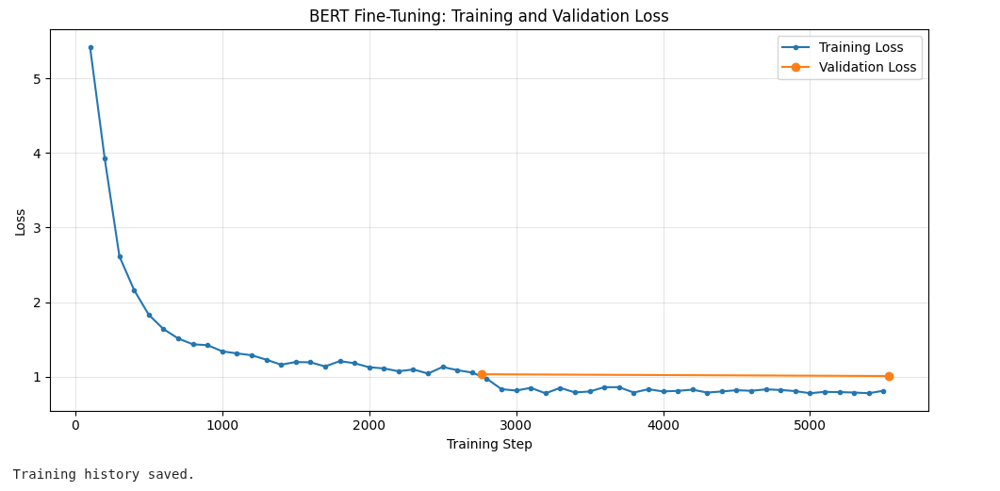
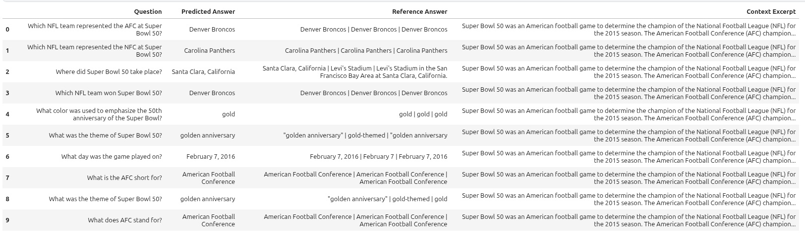
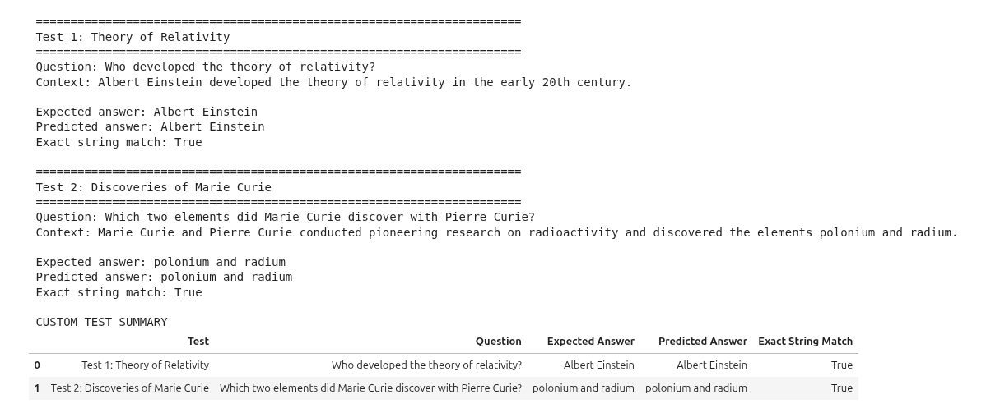

# Fine-Tuning BERT for Extractive Question Answering on SQuAD v1.1

> Natural Language Processing · Hugging Face Transformers

This project fine-tunes a pre-trained `bert-base-uncased` model for **extractive question answering** using the Stanford Question Answering Dataset (SQuAD v1.1). Given a question and a context passage, the model predicts the start and end token positions of an answer within that passage.

**Author:** Sajid Islam  

> **Results note:** The score fields below are intentionally left as placeholders. Replace them with the real results from your executed Colab notebook before publishing. Do not report estimated or unrun metrics as experimental results.

---

## Abstract

Question answering (QA) is an important natural language processing task in which a model identifies an answer to a question using supporting text. Unlike text classification, which assigns an input to a predefined category, extractive QA predicts the token span corresponding to an answer in a context passage. This project fine-tunes the pre-trained `bert-base-uncased` Transformer model on the Stanford Question Answering Dataset (SQuAD v1.1) using the Hugging Face Transformers and Trainer APIs. The workflow includes dataset exploration, question–context tokenization, alignment of annotated answer character offsets with token positions, model fine-tuning, and validation using Exact Match (EM) and token-level F1. Long passages are handled through overlapping context windows, and predicted token spans are converted back into answer text for evaluation. Two custom question–answer examples are also used to inspect behavior on user-provided contexts. The project documents the training configuration, validation metrics, loss curves, and prediction examples to illustrate the practical workflow and limitations of a Transformer-based extractive QA system.

## Project Objectives

- Understand the difference between classification and extractive question answering.
- Load and explore SQuAD v1.1 using Hugging Face Datasets.
- Tokenize question–context pairs and map answer character spans to token positions.
- Fine-tune a pre-trained BERT QA model with the Hugging Face `Trainer` API.
- Evaluate the model using Exact Match and token-level F1.
- Test the model on two custom questions and inspect predicted answers.

## Dataset

- **Dataset:** [SQuAD v1.1](https://huggingface.co/datasets/squad)
- **Loading method:** `datasets.load_dataset("squad")`
- **Fields used:** question, context, answers, and example ID
- **Partitions:** official training and validation splits

The dataset is loaded at runtime from Hugging Face. The dataset itself is not included in this repository.

## Methodology

1. **Dataset exploration:** inspect sample questions, context passages, and answer annotations.
2. **Tokenization:** use the `bert-base-uncased` tokenizer for question–context pairs.
3. **Answer alignment:** map annotated character offsets to token-level start and end positions.
4. **Long-context handling:** use a maximum sequence length of 384 tokens and an overlap stride of 128 tokens.
5. **Fine-tuning:** train `AutoModelForQuestionAnswering` with the Hugging Face `Trainer` API.
6. **Validation:** calculate Exact Match (EM) and token-level F1 with the SQuAD evaluation metric.
7. **Custom testing:** submit two questions with their own contexts and inspect the extracted answer spans.

### Main configuration

| Setting | Value |
|---|---|
| Pre-trained model | `bert-base-uncased` |
| Task | Extractive question answering |
| Dataset | SQuAD v1.1 |
| Epochs | 2 |
| Learning rate | `3e-5` |
| Training batch size | 16 when CUDA GPU is available; otherwise 4 |
| Maximum sequence length | 384 |
| Document stride | 128 |
| Random seed | 42 |
| Trainer API | Hugging Face `Trainer` |
| Evaluation metrics | Exact Match (EM), token-level F1 |

The effective batch size and runtime depend on the kaggle hardware.

## Results

| Metric | Validation result |
|---|---:|
| Exact Match (EM) | `80.17` |
| Token-level F1 | `87.75` |
| Validation loss | `1.0089569091796875` |
| Fine-tuning time (minutes) | `109.70 minutes` |

### Custom question-answering tests

| Test | Expected answer | Model prediction | Exact string match |
|---|---|---|---|
| Theory of relativity | Albert Einstein | `Albert Einstein` | `True` |
| Marie Curie discoveries | polonium and radium | `polonium and radium` | `True` |

> The custom tests' exact-string comparison is not the same as the normalized SQuAD EM metric. Punctuation or a semantically equivalent alternative answer can affect exact-string matching.

### Training and validation loss



### Validation prediction examples



### Custom test output



## Error Analysis and Limitations

Use the actual predictions and validation examples to write a short analysis. Consider whether errors are associated with long passages, answer-span boundaries, ambiguous questions, similar entities, or answers that require reasoning beyond direct extraction. Do not claim that a specific error pattern occurred unless it is visible in your results.

This is an **extractive** QA model: it selects a text span from the provided context rather than freely generating a response. The model may fail when the answer is absent, when the question requires multi-step reasoning, or when the most relevant passage is not provided. The notebook uses a maximum input length of 384 tokens with overlapping windows, and its custom function selects a best-scoring span; it does not implement a calibrated no-answer threshold.

## Reflection


## Repository Structure

```text
QA_FineTuning_SQuAD_Sajid_Islam/
├── README.md
├── ABSTRACT.md
├── RESULTS.md
├── OUTPUTS_GUIDE.md
├── requirements.txt
├── .gitignore
├── QA_FineTuning_SQuAD_Sajid_Islam.ipynb   # Add your downloaded notebook
├── assets/
│   └── figures/
└── outputs/
    ├── README.md
    ├── figures/
    └── tables/
```

## Run the Notebook

1. Open the notebook in [Google Colab](https://colab.research.google.com/) or Jupyter.
2. Enable a GPU runtime if one is available.
3. Run the notebook cells in order. The dataset and pre-trained model are downloaded when needed.
4. Review the validation EM/F1 results, custom test predictions, and loss plot.
5. Copy the actual metrics into this README and `RESULTS.md`, and add the output figures listed in `OUTPUTS_GUIDE.md`.

## References

- Rajpurkar, P. et al. (2016). [SQuAD: 100,000+ Questions for Machine Comprehension of Text](https://aclanthology.org/D16-1264/). EMNLP.
- [Hugging Face Transformers: Question Answering](https://huggingface.co/docs/transformers/tasks/question_answering)

